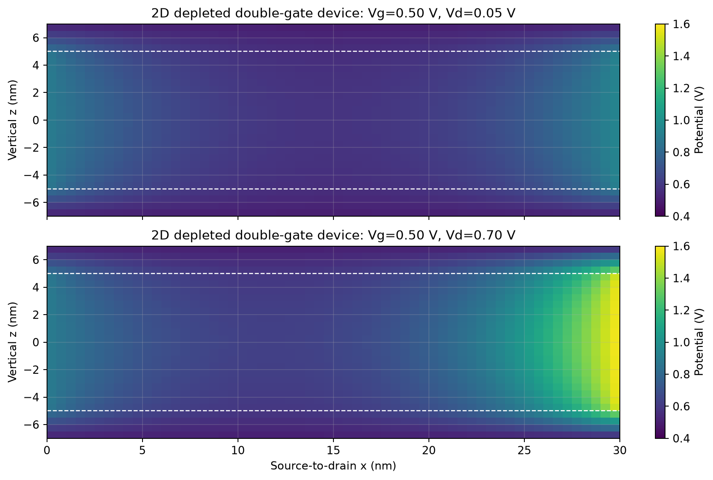

# mini-tcad-mosfet-2d

**二维双栅 MOSFET 静电学：短沟道势垒、DIBL、介质边缘场与约束设计。**

这是 [PN 结静电学](https://github.com/carveself/mini-tcad-pn)、[MOS 电容](https://github.com/carveself/mini-tcad-moscap)、[一维漂移-扩散](https://github.com/carveself/mini-tcad-drift-diffusion)之后的第四个教学项目。TCAD（Technology Computer-Aided Design，工艺与器件计算机辅助设计）在这里用于研究器件几何如何控制电势。MOSFET（Metal-Oxide-Semiconductor Field-Effect Transistor，金属-氧化物-半导体场效应晶体管）是研究对象；Double-Gate（双栅）指上下两面栅极共同控制硅膜。

这里的“二维”指 x-z 空间截面，材料仍是硅与理想介质，不是二维材料晶体管。



研究问题：漏极电势能传入沟道多远？薄硅膜为何改善栅控？相同 EOT 是否意味着相同短沟道行为？满足给定 DIBL 目标，沟道最短能做到多少？

## 一键运行

Python 3.10 或更新版本：

```bash
git clone https://github.com/carveself/mini-tcad-mosfet-2d.git
cd mini-tcad-mosfet-2d
python -m venv .venv
# macOS / Linux
source .venv/bin/activate
# Windows PowerShell 则使用：.venv\Scripts\Activate.ps1
python -m pip install -r requirements.txt
python run_all.py
python -m unittest discover -s tests -v
```

自动保存 **8 张图、10 个 CSV、1 个 NPZ 二维数组和 2 个 JSON**；14 项测试已实际通过。计算无需弹出图形窗口。默认输出在项目的 `figures/`，重复运行覆盖同名结果。

```bash
python run_all.py --spacing 0.25 --output reproduction/fine
python src/stages.py baseline --output reproduction/01-baseline
python src/stages.py verify --output reproduction/02-verification
python src/stages.py screening --output reproduction/03-screening
python src/stages.py dielectric --output reproduction/04-dielectric
python src/stages.py design --output reproduction/05-design
```

`--spacing` 是目标网格间距，单位 nm；每层取整数个单元，界面准确落在单元面上。验证实验还会细化到该间距的 1/4。相对的自定义输出路径相对于运行命令的目录。

## 首次接触的概念

| 术语 | 英文全称、中文含义及用途 |
| --- | --- |
| Poisson equation | 泊松方程；由固定空间电荷与介电常数求二维电势 |
| Fully depleted approximation | 全耗尽近似；硅膜仅保留已电离受主负电荷，移动电子和空穴不参与屏蔽 |
| FVM | Finite Volume Method，有限体积法；按单元积分泊松方程，保持界面通量与整体电荷平衡 |
| FEM | Finite Element Method，有限元法；用独立三角形线性基函数装配另一套参考解 |
| DIBL | Drain-Induced Barrier Lowering，漏致势垒降低；衡量漏压升高使栅控势垒判据电压下降的程度 |
| EOT | Equivalent Oxide Thickness，等效氧化层厚度；把平面介质单位面积电容换算为 SiO2 厚度 |
| Scale length | 尺度长度；描述漏端扰动向沟道内部指数衰减的长度 |
| Maxwell capacitance matrix | 麦克斯韦电容矩阵；表示各端电荷对各端电势的偏导，用于互易性与规范不变性检查 |
| Manufactured solution | 制造解；先指定满足介质界面条件的精确解，再反推源项，检验离散误差阶数 |

## 完成的实验

1. 真实二维分层域：下介质 / 硅 / 上介质，硅侧边为理想源漏接触，介质侧边绝缘。
2. 比较 30 nm、70 nm 沟道中心线的源端电子势垒；漏压从 0.05 V 增至 0.70 V。
3. 三种硅膜厚度、17 个沟道长度，共 51 个长度扫描点；另有 66 个二维设计空间点。
4. 同为 EOT=2 nm 的三种介质，比较二维边缘电场与全耗尽几何电容。
5. 从二维漏压响应拟合尺度长度，与分层横向模态方程和常用抛物近似比较。
6. 四级网格、制造解、独立 FEM、长沟道解析极限、整体高斯定律和电容互易性。
7. 在 20-100 nm 的搜索区间内，寻找 DIBL≤50 mV/V 的最短沟道；两级网格复核设计。


## 阈值与 DIBL 的定义必须说清楚

本项目定义中心线势垒为 `B = psi_source - min_x psi(x,z=0)`，数值以 eV 表示，并用三个相邻点的局部抛物线细化极小值。电子能量与电势符号相反，因此这个最小电势对应最大导带势垒。

**势垒判据电压 Vth,B** 是使 B=0.20 eV 的栅压；本项目的 DIBL 为：

```math
\mathrm{DIBL}_B=1000\frac{V_{th,B}(0.05)-V_{th,B}(0.70)}{0.70-0.05}\quad\mathrm{mV/V}.
```

它是本模型内的中心线静电指标，不能直接替代实测恒流阈值、强反型阈值或完整输运求解得到的 DIBL。没有求漏极电流，也没有把势垒指数擅自标成 A。源接触电势 0.9 V 是给定的有效边界参数，不声称由某个重掺杂源区模型提取。

## 基准结果

基准：硅厚 10 nm，介质厚 2 nm，介质相对介电常数 3.9，硅为 11.7，受主浓度 1e17 cm⁻³，上下栅相同，平带电压为零。默认单元目标间距 0.5 nm。

| 量 | 结果，约值 |
| --- | ---: |
| L=30 nm，低漏压势垒判据电压 | 0.649876 V |
| L=30 nm，高漏压势垒判据电压 | 0.593427 V |
| L=30 nm 的 DIBL | 86.844 mV/V |
| L=50 nm 的 DIBL | 13.808 mV/V |
| 二维拟合尺度长度 | 6.30837 nm |
| 分层基模尺度长度 | 6.30503 nm |
| 抛物近似尺度长度 | 5.47723 nm，低估约 13.13% |
| 制造解最后一级误差阶数 | 1.996 |
| 0.125 nm 网格 FVM/FEM 势垒差异 | 0.1107 meV |


**完整域最大电势差异仍约 27.87 mV，集中在源漏接触终点附近**；完整域 RMS 差异约 0.672 mV，排除距源漏各 3 nm 的区域后最大差异约 0.767 mV。混合边界交接处降低了解的光滑性，两种离散的端点处理也不同。不能拿中心势垒的微小差异，宣称整个器件各点都具有同样精度。制造解为光滑的另一问题，其二阶结果也不能直接外推到有接触奇异性的器件。

## 从仿真走向一个约束设计

固定介质厚 2 nm、k=3.9、势垒判据和两档漏压，在模型内搜索 DIBL≤50 mV/V 的长度边界：

| 硅厚 | 0.5 nm 网格的最短 L | 0.25 nm 网格复核搜索 |
| --- | ---: | ---: |
| 6 nm | 26.225 nm | 26.248 nm |
| 10 nm | 35.547 nm | 35.563 nm |
| 16 nm | 48.341 nm | 48.353 nm |

实际讨论取约 26.2、35.6、48.4 nm 即可；搜索器的 0.01 nm 停止容差不代表物理精度。这只是指定模型、搜索区间和目标下的边界，不是工艺节点、流片规则或同时优化漏电/驱动/可靠性后的最优器件。


## 同 EOT 不等于完全相同的二维几何

2 nm/k=3.9、4 nm/k=7.8、10 nm/k=19.5 均为 EOT=2 nm。L=30 nm 时，这三个理想结构的 DIBL 分别约 86.84、95.91、141.66 mV/V。横向边缘场会受实际介质厚度影响；这个结论仅针对所定义的结构与边界。这里的 k 值是理想参数，不是某种真实高 k 材料的完整模型。


全耗尽固定电荷下，长沟道内部会随两个栅一起移动，栅电荷的小信号变化主要来自源漏端附近。因此本项目的**双栅短接电容**在长 L 时趋于端部贡献，不能用作强反型 MOSFET 的面积栅电容。电容单位是 F/m 宽度，乘实际宽度（m）才得到 F。

## 复现材料与项目范围

- [分阶段复现](docs/REPRODUCE.md)：逐步重写、检验、扩展。
- [方程与离散](docs/MODEL.md)：边界、单位、谐均介电常数、独立 FEM 和尺度长度推导。
- [验证记录](docs/VALIDATION.md)：结果路径与各指标能证明什么。
- [项目报告](docs/REPORT.md)：问题、方法、结果、误差和结论。
- [复试口述与追问](docs/INTERVIEW.md)：英文简介、方法选择和个人贡献练习。

模型仅求固定电荷全耗尽静电学；未联立移动载流子与连续性方程，也未包含量子限域、隧穿、陷阱、迁移率、接触电阻或自热。极短厚硅结构可能出现负的势垒判据栅压，相关数值只是固定电荷数学模型的外推，可能不再满足实际全耗尽假设。原始表保留这些点用于识别范围失效。源漏附近的移动电荷屏蔽也未被建模。纳米尺度计算用于经典静电学练习，不代表制造可行性。

参考实现和数据已由工具辅助制作；复现时保留基准，记录自己重写的函数、排错和扩展，只按真实贡献描述项目。项目能用于练习器件物理、数值方法和研究表达，不保证特定院校录取或加分。

## 参考资料

- [TU Wien：短器件中的漏致势垒降低](https://iue.tuwien.ac.at/phd/wittmann/node6.html)。
- [Das 等，Nature Electronics 2021，Box 1 的双栅尺度长度讨论](https://www.iue.tuwien.ac.at/pdf/ib_2021/JB2021_Grasser_1.pdf)。本文研究的是硅截面，不复现该综述的二维材料器件数据。
- [COMSOL：完整器件模型需要泊松与漂移-扩散方程](https://doc.comsol.com/6.3/doc/com.comsol.help.semicond/semicond_ug_semiconductor.6.02.html)。
- [SciPy：稀疏 LU 分解](https://docs.scipy.org/doc/scipy/reference/generated/scipy.sparse.linalg.splu.html)。
