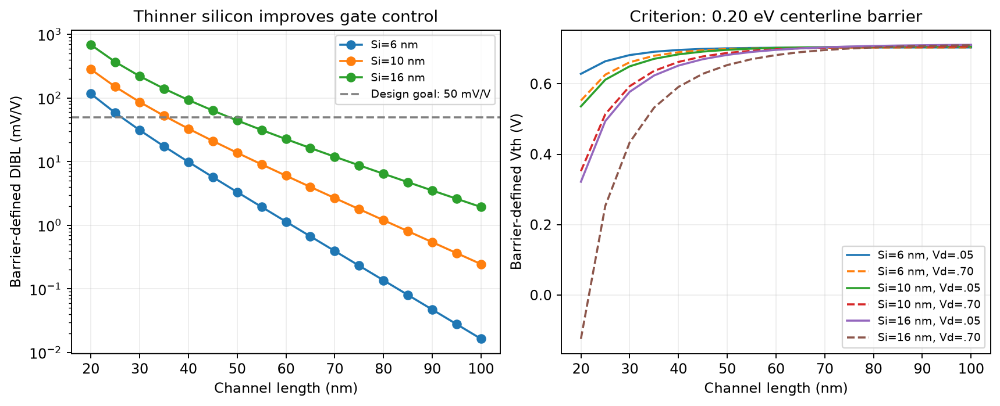
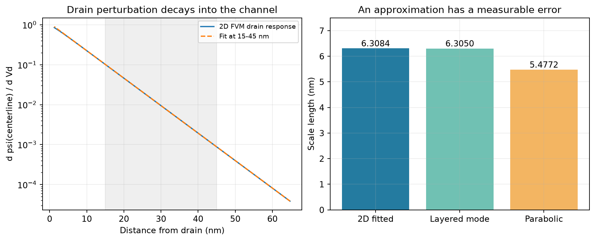
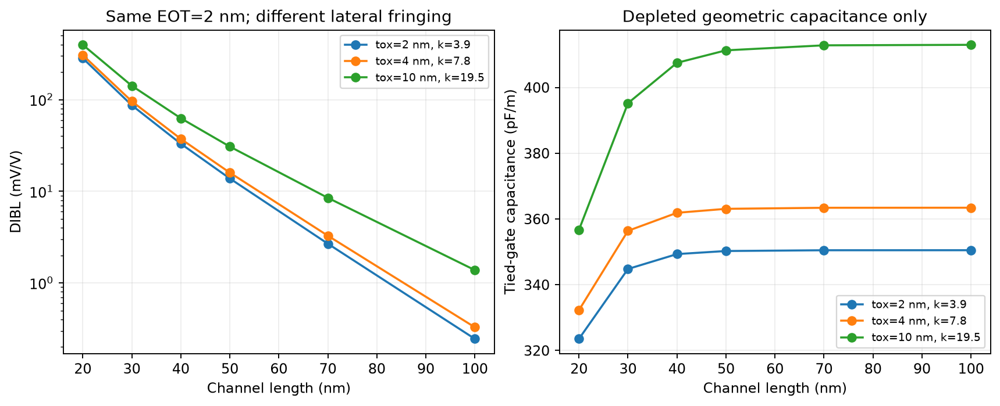
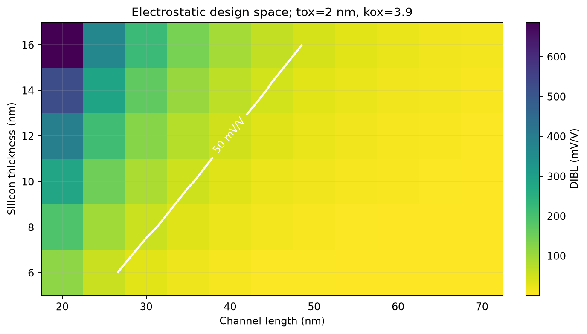
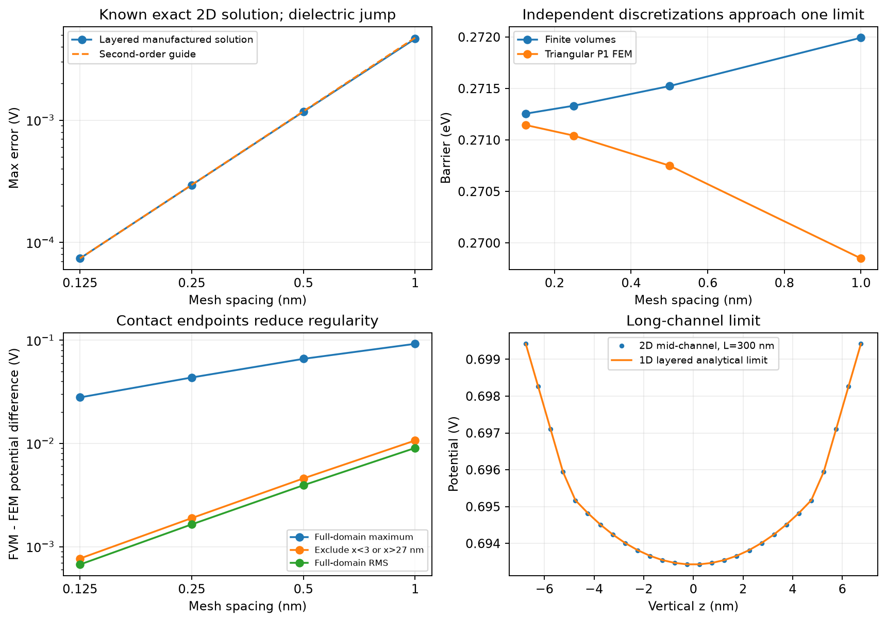

# 二维双栅硅器件的短沟道静电与约束设计

## 问题

一维 MOS 电容揭示纵向栅控，一维 PN 漂移-扩散给出输运。本项目将空间拓展到二维，专门研究源漏与栅的静电竞争：漏压如何降低沟道势垒，几何如何抑制这种影响，以及用什么证据相信数值趋势。

采用固定电荷全耗尽模型，使问题聚焦于二维介质界面、边界、独立离散和设计指标。项目不求漏极电流；其阈值为明确规定的中心线 0.20 eV 势垒判据，不等同于实测阈值。

## 方法

区域为介质/10 nm 硅/介质，上下各 2 nm、k=3.9，硅 k=11.7。硅内受主 1e17 cm⁻³，源电势 0.9 V，漏电势 0.9+Vd，上下栅共同为 Vg，平带偏移为零。介质侧壁绝缘。

有限体积法按介质串联电阻处理共享面通量，稀疏 LU 求解二维泊松方程。固定电荷问题线性，预计算四端响应后可准确重建任意偏压解。另用独立 P1 三角形有限元装配参考系统。

通过势垒判据求两档漏压的栅压，再提取 DIBL。用四端通量计算端电荷与麦克斯韦电容，检查守恒、互易、规范不变性和正半定性。尺度长度由二维空间响应拟合，并与横向分层基模方程比较。

## 结果一：几何改变栅控

基准 30 nm 沟道，低/高漏压的势垒判据栅压约 0.649876/0.593427 V，DIBL 约 86.844 mV/V。50 nm 沟道约 13.808 mV/V。固定其余条件，硅膜越薄、沟道越长，漏端对源端势垒的控制越弱。

L=30/70 nm 的势垒剖面还显示漏压升高会移动势垒位置；因此不能把整个剖面只当作一个固定位置的刚性平移。

## 结果二：尺度长度近似需要验证

基准二维拟合长度 6.30837 nm，分层基模方程 6.30503 nm，相对差异约 0.053%。常用小角抛物近似为 5.47723 nm，低估约 13.13%。这表明尺度长度公式不是不带条件的常数；应核查氧化层与硅膜厚度和尺度长度的比例。

## 结果三：同 EOT 仍有边缘场差异

EOT 同为 2 nm 的三组 tox/k 为 2/3.9、4/7.8、10/19.5。L=30 nm 的 DIBL 约 86.84、95.91、141.66 mV/V。EOT 约束一维平面电容，实际介质厚度仍影响二维横向场。这是理想介质参数对照，不包含某种真实高 k 材料的陷阱、带阶或可靠性模型。

固定电荷条件下的双栅短接电容主要反映端部场贡献，不能当作完整器件强反型栅电容，也不能据此评估完整开关能耗。

## 结果四：一个有条件的设计答案

以 DIBL≤50 mV/V 为目标，搜索 20-100 nm 沟道范围，在默认介质和边界下：tsi=6/10/16 nm 的细网格长度边界约为 26.248/35.563/48.353 nm。相应粗网格为 26.225/35.547/48.341 nm。

这是单一静电目标，不是同时考虑驱动、漏电、工艺、量子限域和可靠性后的真实工艺最优解。报告取约 26.2/35.6/48.4 nm，保留网格条件与判据。

## 验证与尚存的误差

制造解最终误差阶 1.996，长沟道中部解析差异约 4.83 μV。独立 FVM/FEM 在 0.125 nm 网格上的中心势垒差约 0.1107 meV，但全域最大电势差仍约 27.87 mV、RMS 约 0.672 mV，差异集中于接触端点。排除两端各 3 nm 后最大约 0.767 mV。

光滑制造解的二阶阶数不能外推为有混合边界奇异点的真实器件全域二阶。高斯平衡与电容互易接近机器精度体现保守装配，不能独自证明物理模型正确。两套离散还共享固定电荷假设。

14 项测试通过，覆盖对称性、规范自由度、守恒、电容导数、独立解、制造解、尺度长度、解析极限、趋势与失败处理。

## 结论与复现贡献

在本模型范围内，薄硅膜与长沟道改善源端势垒控制；相同 EOT 并不消除二维实际几何的差异；尺度长度的常用近似存在可量化误差。可信度来自已知解、独立离散、网格、局部误差与守恒的联合检查。

复现时可选择一个方向深入：拟合区间与模态污染、独立上下栅耦合、同 EOT 与同物理厚度对照、接触端点误差、势垒判据改变对约束设计的影响。完成后用自己的失败记录、修复和扩展说明实际贡献。
